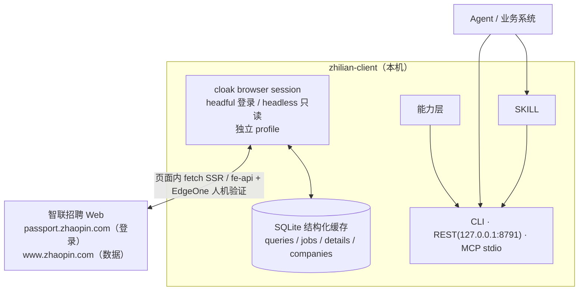

# zhilian-client

智联招聘（Web）**本地只读客户端**：复用 `cloak-env` 的 cloakbrowser 运行环境与独立 profile 保活登录态，把「职位搜索 / 职位详情 / 公司列表 / 公司详情（含工商信息）/ 公司全部职位 / 城市 / 状态」以 **CLI / REST / MCP / SKILL** 四种形态暴露给 Agent 与业务系统。

> 本项目与智联招聘官方无关；仅使用本人/授权账号做低频只读查询，请遵守平台服务条款。

## 状态

**v0.1 已实现并本机运行**（2026-11-14）——匿名链路 + 真实账号登录/会话续期已实测；CLI / REST / MCP 三通道已联调通过；`zhilian-client.service` 以 systemd user 常驻在 `http://127.0.0.1:8791`（REST + `/docs` + `/openapi.json`）。

- 运行状态：`systemctl --user status zhilian-client`；日志 `journalctl --user -u zhilian-client`
- 接口文档：`http://127.0.0.1:8791/docs`（自包含 HTML）、`http://127.0.0.1:8791/openapi.json`
- 认证：REST 除 `/v1/health` 外需要 `Authorization: Bearer <ZHILIAN_API_TOKEN>`（见本机 `.env`，600 权限）

- PRD：[docs/01-需求文档.md](docs/01-需求文档.md)
- 接口草案：[docs/02-接口草案.md](docs/02-接口草案.md)
- 需求访谈/决策：[docs/00-需求访谈记录.md](docs/00-需求访谈记录.md)
- 实测记录：[exploration/2026-11-14/REPORT.md](exploration/2026-11-14/REPORT.md)
- 部署与使用：[docs/03-部署与使用.md](docs/03-部署与使用.md)
- 环境配套：[docs/04-环境配套.md](docs/04-环境配套.md)

## 能力（v0.1 已实现）

| 能力 | CLI | REST | MCP |
| --- | --- | --- | --- |
| 健康检查 | `zhilian health` | `GET /v1/health` | `zhilian_health` |
| 登录态/模式/会话/EdgeOne/风控 | `zhilian status` | `GET /v1/status` | `zhilian_status` |
| 登录（智联APP扫码 / 短信） | `zhilian login` | `POST /v1/session/login*` | `zhilian_login_*` |
| 人机验证（EdgeOne / 极验 / NC） | `zhilian verify` | `GET/POST /v1/verification*` | `zhilian_verification_*` |
| 职位搜索 | `zhilian search jobs` | `POST /v1/search/jobs` | `zhilian_search_jobs` |
| 职位翻页 | `zhilian jobs list` | `GET /v1/jobs` | `zhilian_list_jobs` |
| 职位详情 | `zhilian jobs detail` | `GET /v1/jobs/{positionNumber}` | `zhilian_job_detail` |
| 去重公司列表 | `zhilian companies list` | `GET /v1/companies` | `zhilian_list_companies` |
| 公司详情（含工商） | `zhilian companies detail` | `GET /v1/companies/{companyNumber}` | `zhilian_company_detail` |
| 公司全部职位 | `zhilian companies jobs` | `GET /v1/companies/{companyNumber}/jobs` | `zhilian_company_jobs` |
| 城市注册表 | `zhilian cities list` | `GET /v1/cities` | `zhilian_cities` |
| 缓存统计/清理 | `zhilian cache stats/clear` | `GET/DELETE /v1/cache*` | `zhilian_cache_*` |

## 架构



- **浏览器**：复用 `~/cloak-env`（cloakbrowser 0.6.5 + Chromium 146）；独立 profile `~/.zhilian-client/profile`，不与 boss-client / tanji-client 共用。
- **只读**：不投递、不沟通、不改简历、不收藏；不写 CRM。
- **结构化缓存**：SQLite，不落 raw 响应/HTML、不存 cookie/token/验证码。
- **采集最小化**：页面内 `fetch` SSR 文档并解析 `__INITIAL_STATE__`；详情优先 `position-detailv3` API，尽量不加载完整页面与子资源。
- **人机验证**：EdgeOne（30 天 token）与登录 NC/极验均支持「中继（截图+坐标）/自动点击」。

## 快速开始

```bash
# 前置：~/cloak-env 可用
~/cloak-env/bin/cloak-env-info

# 安装
npm install
cp .env.example .env         # 至少修改 ZHILIAN_API_TOKEN
npm run build
npm test
npm run gen

# 登录（首次/掉线人工一次）
zhilian login                # 智联APP扫码
zhilian login --sms          # 短信（需 headful）

# 查询
zhilian status
zhilian search jobs --keyword 外贸 --city 565 --pages 1
zhilian jobs detail --number CCL1316344860J40974823208
zhilian companies list --query-id q_...
zhilian companies detail --number CZL...
zhilian companies jobs --number CZL...
zhilian cities list
```

## 服务与运维

```bash
# 安装为 systemd user 服务（已在本机完成）
mkdir -p ~/.config/systemd/user
cp systemd/zhilian-client.service ~/.config/systemd/user/
systemctl --user daemon-reload
systemctl --user enable --now zhilian-client

# 本机 CLI
ln -sf "$PWD/bin/zhilian-run" ~/.local/bin/zhilian
zhilian status

# MCP（默认代理到常驻 REST，不打开第二个浏览器）
# MCP 客户端配置：
#   command: /path/to/zhilian-client/bin/zhilian-run
#   args: ["mcp"]
#   env: { ZHILIAN_CLIENT_URL: "http://127.0.0.1:8791", ZHILIAN_API_TOKEN: "<token>" }
```

> **人机验证**：智联的 EdgeOne 可能拦截 `/companydetail/*`、`/jobdetail/*` 等页面。客户端会返回 `HUMAN_VERIFICATION_REQUIRED` 并在 `GET /v1/verification` 暴露截图/iframe/复选框信息；`POST /v1/verification/solve {"kind":"edgeone","auto":true}`（或人工点击坐标）通过后即可重试。默认 `ZHILIAN_EDGE_AUTO=false`（中继优先，可用 `zhilian verify solve --kind edgeone --auto` 手动自动过）。

## 文档

- 设计文档见 [docs/](docs/)
- 实测记录见 [exploration/](exploration/)

## 安全与合规

- REST 仅 `127.0.0.1:8791` + Bearer；profile/cache/log 权限 600/700。
- 二维码、验证码、短信码、cookie/token 不落长期日志；登录/验证中继仅本机。
- 只读；低频；单账号；不做账号共享/批量导流。
- 请遵守智联招聘用户协议与当地法律；因使用产生的账号/合规风险由使用者承担。

## License

[MIT](LICENSE) © 2026 CindyRIng
