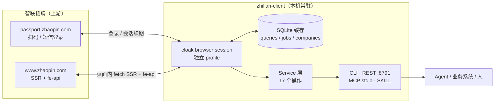
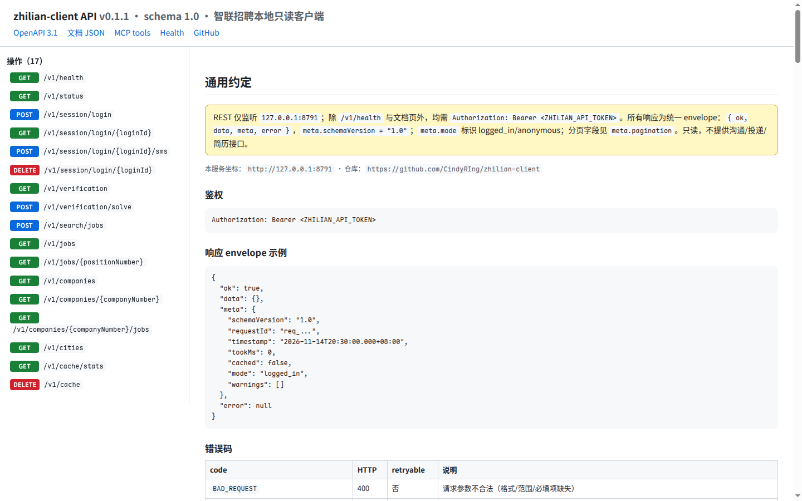

<div align="center">


# zhilian-client

**智联招聘 Web 的本地只读客户端**

一次性登录 · 独立浏览器会话 · SQLite 缓存 · `CLI / REST / MCP / SKILL` 四通道

<p>
  
  
  
  
  
  
</p>

[快速开始](#-快速开始) · [能力矩阵](#-能力矩阵) · [三种接入方式](#-三种接入方式) · [文档](#-文档) · [实测数据](#-实测数据)

</div>


> [!NOTE]
> 本项目与智联招聘官方无关。仅使用本人账号或已授权账号做**低频、只读**查询（不投递、不沟通、不改简历、不收藏），请遵守平台服务条款与当地法律。

> [!TIP]
> **当前状态：v0.1.1 · 已实现并本机常驻运行**。REST 监听 `127.0.0.1:8791`，`/v1/health` 毫秒级、登录态 `logged_in`；35 个单测通过，OpenAPI/MCP/CLI 生成物与实现同源。

## 🎯 这是什么

把**智联招聘 Web**（登录域 `passport.zhaopin.com` + 数据域 `www.zhaopin.com`）封装成本机常驻的只读客户端：

- 用真实浏览器会话（cloakbrowser + 独立 profile）保住登录态；
- 把页面 SSR / fe-api 的数据结构化成职位、公司、工商信息、城市；
- 通过 **CLI / REST / MCP / SKILL** 四种形态交给 Agent 与业务系统，全程只读。

它适合这样的场景：招聘信号 → 公司线索 → 工商信息核验，例如把「某城市 + 某关键词」的在招职位批量转成公司名单，再逐家补齐工商信息。

## ✨ 核心特性

| | 特性 | 说明 |
| --- | --- | --- |
| 🕹️ | **真浏览器会话** | cloakbrowser 指纹环境 + 独立 profile；扫码/短信登录一次，`at`≈7 天、`rt`≈30 天自动续期 |
| 🧠 | **结构化输出** | 17 个操作统一 envelope（`ok/data/meta/error`），zod schema 单一事实源 |
| 🗄️ | **本地 SQLite 缓存** | 结构化缓存（不落 HTML、cookie、验证码），搜索/详情/公司默认 2h～7d TTL，可 `refresh` 强制回源 |
| 🛡️ | **只读安全** | 无投递/沟通/简历写操作；REST 仅监听 `127.0.0.1` + Bearer；敏感信息不进日志 |
| 🤖 | **Agent 友好** | 17 个 MCP tools、SKILL 工作流、CLI 都可直接用；MCP 默认代理常驻 REST，不抢 profile |
| 🔁 | **反爬中继** | EdgeOne 30 天 token；验证码/人机验证支持「截图+坐标中继」与「自动点击」两种模式 |

## 🧭 架构




<details>
<summary>展开：只读与数据最小化约束</summary>

- **只读**：不投递、不沟通、不改简历、不收藏、不写 CRM；
- **采集最小化**：页面内 `fetch` SSR 文档并解析 `__INITIAL_STATE__`；职位详情优先 `position-detailv3` API；
- **不落敏感数据**：缓存只存结构化字段；二维码/验证码/cookie/token 不写长期日志；
- **单实例**：浏览器 profile 由文件锁保护，同一时间只有一个进程使用。
</details>

## 🖥️ 界面预览

REST 文档页（真实运行截图，`http://127.0.0.1:8791/docs`）：



- **REST**：`/docs` 自包含 HTML、`/openapi.json`（OpenAPI 3.1）、`/mcp-tools.json`
- **CLI**：`zhilian --help` 全命令自文档化
- **MCP**：17 个 `zhilian_*` tools，可直接接入 Claude Desktop / Cursor / 其他 MCP 客户端

## 🚀 快速开始

```bash
# 0) 前置：Node ≥ 22.5，且本机 cloak-env 可用
~/cloak-env/bin/cloak-env-info

# 1) 安装
git clone https://github.com/CindyRIng/zhilian-client.git
cd zhilian-client
npm install
cp .env.example .env          # 至少把 ZHILIAN_API_TOKEN 改成随机值
npm run build
npm test                      # 35 个单测，不启动浏览器

# 2) 登录（首次 / 掉线后各一次）
bin/zhilian-run login         # 智联 APP 扫码（默认）
bin/zhilian-run login --sms   # 或短信验证码

# 3) 查询
bin/zhilian-run status
bin/zhilian-run search jobs --keyword 外贸 --city 565 --pages 2
bin/zhilian-run jobs detail --number CCL1316344860J40974823208
bin/zhilian-run companies list --query-id q_...
bin/zhilian-run companies detail --number CZL1316344860
bin/zhilian-run companies jobs --number CZL1316344860
bin/zhilian-run cities list

# 4) 常驻 REST 服务
node dist/main.js serve --port 8791
# 打开 http://127.0.0.1:8791/docs
```

> 建议把 `bin/zhilian-run` 软链到 `~/.local/bin/zhilian`，之后直接用 `zhilian ...`：
> `ln -sf "$PWD/bin/zhilian-run" ~/.local/bin/zhilian`

<details>
<summary>展开：安装为 systemd user 服务</summary>

```bash
mkdir -p ~/.config/systemd/user
cp systemd/zhilian-client.service ~/.config/systemd/user/
systemctl --user daemon-reload
systemctl --user enable --now zhilian-client

systemctl --user status zhilian-client
journalctl --user -u zhilian-client -f
```

</details>

## 🧩 能力矩阵

| 能力 | CLI | REST | MCP |
| --- | --- | --- | --- |
| 健康检查 | `zhilian health` | `GET /v1/health` | `zhilian_health` |
| 登录态/模式/会话/风控 | `zhilian status` | `GET /v1/status` | `zhilian_status` |
| 扫码 / 短信登录 | `zhilian login` | `POST /v1/session/login*` | `zhilian_login_*` |
| 人机验证中继 | `zhilian verify` | `GET/POST /v1/verification*` | `zhilian_verification_*` |
| 关键词 + 城市搜索 | `zhilian search jobs` | `POST /v1/search/jobs` | `zhilian_search_jobs` |
| 按 queryId 翻页 | `zhilian jobs list` | `GET /v1/jobs` | `zhilian_list_jobs` |
| 职位详情 | `zhilian jobs detail` | `GET /v1/jobs/{positionNumber}` | `zhilian_job_detail` |
| 去重公司列表 | `zhilian companies list` | `GET /v1/companies` | `zhilian_list_companies` |
| 公司详情（含工商） | `zhilian companies detail` | `GET /v1/companies/{companyNumber}` | `zhilian_company_detail` |
| 公司**全部**在招职位 | `zhilian companies jobs` | `GET /v1/companies/{companyNumber}/jobs` | `zhilian_company_jobs` |
| 城市注册表 | `zhilian cities list` | `GET /v1/cities` | `zhilian_cities` |
| 缓存统计 / 清理 | `zhilian cache stats/clear` | `GET/DELETE /v1/cache*` | `zhilian_cache_*` |


## 🔌 三种接入方式

### 1）CLI

```bash
zhilian --help
zhilian search jobs --keyword 外贸 --city 565 --pages 2 --format table
zhilian jobs detail --number CCL1316344860J40974823208 | jq '.data.title'
```

### 2）REST（默认 `http://127.0.0.1:8791`）

除 `/v1/health` 与文档端点外都需要 Bearer：

```bash
export ZHILIAN_API_TOKEN="$(grep '^ZHILIAN_API_TOKEN=' .env | cut -d= -f2)"

curl -s -X POST http://127.0.0.1:8791/v1/search/jobs \
  -H "Authorization: Bearer $ZHILIAN_API_TOKEN" \
  -H 'content-type: application/json' \
  -d '{"keyword":"外贸","cityCode":"565","pages":2}' | jq '{ok, queryId: .data.query.queryId, jobs: (.data.jobs|length)}'

curl -s -H "Authorization: Bearer $ZHILIAN_API_TOKEN" \
  http://127.0.0.1:8791/v1/companies/CZL1316344860 | jq '.data.business'
```

所有响应统一 envelope：

```json
{ "ok": true, "data": {}, "meta": { "schemaVersion": "1.0", "mode": "logged_in", "cached": false }, "error": null }
```

### 3）MCP（默认代理到常驻 REST）

```json
{
  "mcpServers": {
    "zhilian": {
      "command": "/path/to/zhilian-client/bin/zhilian-run",
      "args": ["mcp"],
      "env": {
        "ZHILIAN_CLIENT_URL": "http://127.0.0.1:8791",
        "ZHILIAN_API_TOKEN": "<从 .env 读取>"
      }
    }
  }
}
```

MCP 工具共 17 个，命名为 `zhilian_*`，参数与 REST/CLI 同源；`SKILL` 见 [skills/zhilian/SKILL.md](skills/zhilian/SKILL.md)。

## ⚙️ 常用配置（完整见 [docs/03](./docs/03-部署与使用.md)）

| 变量 | 默认 | 说明 |
| --- | --- | --- |
| `ZHILIAN_API_TOKEN` | `change-me` | REST/MCP 认证 token，**必须修改** |
| `ZHILIAN_HOST` / `ZHILIAN_PORT` | `127.0.0.1` / `8791` | 仅允许 loopback |
| `ZHILIAN_HEADLESS` | `true` | headless 只读；首次短信登录需 headful |
| `ZHILIAN_CITIES` | `565` | 默认城市码（石家庄） |
| `ZHILIAN_SORT_TYPE` | `JOB_PUBLISH_TIME` | 默认排序 |
| `ZHILIAN_EDGE_AUTO` | `false` | EdgeOne 自动点击开关（也可走 `verification` 中继） |
| `ZHILIAN_CACHE_*_TTL` | 2h / 7d | 列表 / 详情缓存时间 |

## 📚 文档

| 文档 | 内容 |
| --- | --- |
| [docs/README](./docs/README.md) | 文档索引与阅读路径 |
| [00 需求访谈记录](./docs/00-需求访谈记录.md) | 背景、用户结论、探路结论、命名/端口/默认值决策 |
| [01 需求文档（PRD）](./docs/01-需求文档.md) | 目标/非目标、架构、功能需求、风控、验收 |
| [02 接口草案](./docs/02-接口草案.md) | envelope、错误码、17 个操作、数据模型、上游字段映射 |
| [03 部署与使用](./docs/03-部署与使用.md) | 安装、配置、登录、CLI/REST/MCP、systemd、排障 |
| [04 环境配套](./docs/04-环境配套.md) | cloak-env/FHS、profile、DISPLAY、权限、FAQ |
| [实测记录](./exploration/2026-11-14/REPORT.md) | 2026-11-14 探路与联调实测（含登录、EdgeOne、分页） |

## 🧪 实测数据（2026-11-14，真实账号）

| 验证项 | 结果 |
| --- | --- |
| 登录态 | `loggedIn=true`、`mode=logged_in`、`health=ok`；`at`≈7d / `rt`≈30d |
| 搜索 | 石家庄「外贸」20 条；`pages=2` → 40 条 / 去重公司 37 家 |
| 职位详情 | `position-detailv3` 直取：薪资/描述/地址/招聘者/公司完整 |
| 公司详情 | 含工商信息（USCC、法人、注册资本、经营范围）；EdgeOne 中继后成功 |
| 公司全部职位 | **21/21 全量**（fe-api 分页接口，`truncated=false`） |
| 城市 | 461 个城市（含直辖市，默认石家庄 565） |
| 测试与生成物 | 35 个单测通过；OpenAPI 16 paths / 73 schemas；MCP 17 tools |

## 🔒 安全与合规

- REST 仅监听 `127.0.0.1:8791`，Bearer 鉴权；profile / cache / log 权限 `600/700`。
- 二维码、验证码、短信码、cookie/token 不落长期日志；登录与验证中继仅在本机进行。
- 只读、低频、单账号；不做账号共享、批量导流或商业转售。
- 请遵守智联招聘用户协议与当地法律；使用产生的账号/合规风险由使用者承担。

## 📁 项目结构

```text
zhilian-client/
├── src/                 # 实现：domain / adapters / session / cache / api / transports
├── tests/               # 35 个单元测试
├── spec/                # 自动生成：OpenAPI / MCP tools / CLI commands / schemas
├── docs/                # 设计、接口、部署、环境文档 + assets 图片素材
├── exploration/         # 上游探路与联调实测记录
├── skills/zhilian/      # SKILL 工作流
├── systemd/             # systemd user unit
└── bin/zhilian-run      # cloak-env FHS 包装启动器
```

## ❤️ 致谢

- 架构与工程约定参考同机 [boss-client](https://github.com/CindyRIng/boss-client)（MIT，© CindyRIng）。
- 视觉素材：`hero-banner` / `logo` / `architecture-illustration` / `social-preview` 由 **MiniMax-H3-Image** 生成；`rest-docs.png` 为真实运行截图。
- 上游数据归智联招聘所有；本项目仅做本地个人用途的只读读取。

## License

[MIT](LICENSE) © 2026 CindyRIng
