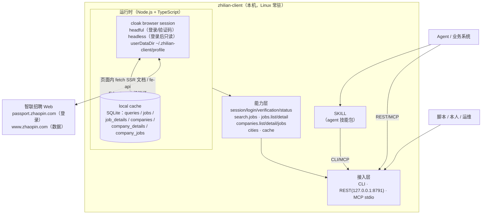

# zhilian-client 需求文档（PRD）

| 项 | 内容 |
| --- | --- |
| 版本 | v0.1（已实现，2026-11-14） |
| 日期 | 2026-11-14 |
| 状态 | 已实现并本机运行（CLI + REST + MCP）；登录/会话续期已实测；见 §14 实现与联调结果 |
| 关联文档 | [00 访谈记录](./00-需求访谈记录.md)、[02 接口草案](./02-接口草案.md)、[03 部署与使用](./03-部署与使用.md)、[04 环境配套](./04-环境配套.md)、[实测记录](../exploration/2026-11-14/REPORT.md) |
| 一句话定位 | 在本机常驻一个「cloak 浏览器 + 智联招聘 Web」的只读客户端，复用独立 profile 保活登录态，把职位搜索、职位详情、公司列表、公司详情（含工商信息）、公司全部职位、状态与登录中继能力，以 CLI / REST / MCP / SKILL 四种形态暴露给 Agent 与其他业务系统。 |

---

## 1. 背景与目标

### 1.1 背景

- 智联招聘（`zhaopin.com`）是招聘平台，**没有可直接使用的开放 API**；日常只能人工搜索职位、翻页、打开职位/公司详情。
- 实际业务用法（与 boss-client 相同）：按「外贸 / 国际贸易 / 海外销售 / 单证 / 跟单」等关键词搜职位 → 找到正在招这类岗位的公司 → 看公司详情/工商信息 → 形成销售线索。
- 本机已有环境：
  - `~/cloak-env`：共享 FHS + cloakbrowser 0.6.5 + Chromium 146（无 license key，keyless 免费档）。
  - `boss-client`：同机正在运行的 BOSS直聘只读客户端（systemd 常驻，REST 8790），是本项目的**同构参照**。
  - `tanji-client`：同机探迹客户端（REST 8787–8789），仅需避免端口/profile 冲突。
- 2026-11-14 已用 cloakbrowser 真实跑通匿名链路：登录页/扫码接口、职位搜索 SSR、职位详情（EdgeOne + position-detailv3 API）、公司详情（含工商信息）、公司全部职位、城市注册表、风控组件观察。详见 [实测记录](../exploration/2026-11-14/REPORT.md)。

### 1.2 目标（v1）

1. **会话保活**：单账号、独立 profile 常驻；重启进程复用登录态；心跳检测；失效时给出明确的人工恢复路径。
2. **能力接口化**：把「职位搜索、翻页、职位详情、公司列表（去重）、公司详情（含工商信息）、公司全部职位、城市注册表、状态」封装为稳定接口。
3. **多形态对外**：CLI、本地 REST、MCP server、agent SKILL 四种形态，返回结构一致。
4. **本地结构化缓存**：SQLite 缓存查询/职位/公司/详情，降低重复请求与风控风险；只存结构化数据，不存 raw 响应。
5. **人机验证可中继**：登录短信验证码/阿里 NC/极验、以及页面级 **EdgeOne** 人机验证，均可通过截图 + 坐标/自动点击的方式由人/远程 Agent 完成。
6. **可运维**：Linux + systemd 常驻；结构化日志；`status` 一眼看到登录态、会话剩余、EdgeOne token 状态、风控冷却、请求计数。
7. **完整文档与机器可读契约**：PRD + 接口草案 + 部署/环境文档 + OpenAPI/MCP/CLI 机器可读 spec（生成物）。

### 1.3 非目标（v1 明确不做）

| 不做 | 说明 |
| --- | --- |
| 官方 API / 开放平台 | 纯浏览器自动化，不依赖智联官方 API |
| 写操作 | 不投递、不沟通、不改简历、不收藏、不关注、不切换招聘者身份 |
| 候选人 / 简历数据 | 只读职位与公司侧公开信息，不读候选人简历 |
| 高级筛选 | v1 只做「关键词 + 城市 + 分页」；薪资/经验/学历/行业/公司规模等筛选留 v1.1（字典已实测存在） |
| 多账号 | v1 单账号；架构预留 |
| Web 控制台 | 不做；只保留 CLI + REST + MCP |
| 文件导出 | 不落 CSV/Excel/PDF；只返回 JSON |
| raw 归档 / 证据链 | 只保留结构化缓存；不落 raw 响应/HTML |
| CRM 写入 | 不直接写 CRM / lead platform；由调用方消费 |
| 代理 IP | v1 不内置；配置位预留 |
| 自动破解验证码 | 不做通用破解；只做「自动点击 EdgeOne 复选框（可配置关闭）」与「人工/中继」两种 |
| 全自动首次登录 | 不承诺；首次/掉线需人工一次 |
| 微信扫码/密码登录实现 | v1 接口预留，实现优先级低于 APP 扫码 + 短信（待评审最终定） |

---

## 2. 术语

| 术语 | 含义 |
| --- | --- |
| zhilian-client | 本文档描述的本机客户端（Node.js 常驻进程） |
| cloak browser session | 用 cloakbrowser 启动的持久化浏览器上下文，承载智联登录态 |
| profile | Chromium userDataDir，默认 `~/.zhilian-client/profile` |
| positionNumber | 智联职位号（`CCL…J…`），用于 `/jobdetail/<number>.htm` 与 `position-detailv3` |
| companyNumber | 智联公司号（`CZL…`/`CZ…`/`CC…`/USCC 形态），用于 `/companydetail/<number>.htm` |
| jl | 智联城市码（489=全国、530=北京、565=石家庄…） |
| order | 搜索排序（实测 `4`=「最新」） |
| queryId | 一次搜索的服务端查询 ID，用于翻页/公司聚合 |
| EdgeOne | 腾讯云 CDN 人机验证（`EO-Bot-Captcha-Token`，实测 30 天） |
| NC / Geetest | 阿里云无痕验证 / 极验 v4，短信发码/登录阶段可能出现 |
| status | 综合状态：登录态 + 模式 + 会话剩余 + EdgeOne token + 风控冷却 + 请求计数 + 缓存 |
| login relay | 登录中继：REST 返回二维码/验证码信息，提交短信码/点击坐标 |
| verification | 通用人机验证中继（EdgeOne 复选框、NC/极验点击/滑块） |
| SKILL | agent 技能包；内部通过 CLI 或 MCP 调用本客户端 |

---

## 3. 用户与场景

### 3.1 角色

| 角色 | 描述 | 使用方式 |
| --- | --- | --- |
| Agent（主） | Claude Code / Codex / DSH 等 agent | SKILL / MCP |
| 其他业务系统 | fuma-sales-dsh、lead platform、CRM 同步任务等 | REST（127.0.0.1 + Bearer） |
| 脚本 / 本人 / 运维 | 临时查询、调试、登录恢复 | CLI / `status` |

### 3.2 用户故事

| ID | 故事 | 验收要点 |
| --- | --- | --- |
| US-01 | 作为使用者，我希望客户端开机自启、长期在线，不需要每天重新登录 | 冷启动复用 profile；心跳；失效提示 |
| US-02 | 作为使用者，我想知道现在能不能查、会话还剩多久、EdgeOne token 是否有效、是否在风控冷却 | `status` 返回登录态、模式、会话/EdgeOne 有效期、冷却 |
| US-03 | 作为 agent，我想按关键词 + 城市搜索职位 | `search.jobs` 返回职位 + 分页 + queryId |
| US-04 | 作为 agent，我想按页拿更多职位 | `jobs.list` 按 queryId 翻页；匿名模式给出限制错误 |
| US-05 | 作为 agent，我想看某个职位的详情 | `jobs.detail` 返回描述、要求、地址、招聘者、公司摘要、工商信息 |
| US-06 | 作为 agent，我想拿到这次搜索命中的公司去重列表 | `companies.list` 按 companyNumber 去重，含职位数 |
| US-07 | 作为 agent，我想看公司详情和完整工商信息 | `companies.detail` 返回工商字段 + 热招职位 |
| US-08 | 作为 agent，我想看某公司在招的全部职位 | `companies.jobs` 返回全部职位 |
| US-09 | 作为使用者，我希望重复查询不要反复打上游 | 缓存命中 `cached=true` |
| US-10 | 作为 agent，我希望 CLI/REST/MCP 返回同一 schema | 三通道同构 |
| US-11 | 作为远程 agent/运维，我想在无头服务器上完成登录与 EdgeOne 验证 | REST 中继 QR/截图/短信码/点击坐标 |
| US-12 | 作为使用者，我想用技能包完成「搜外贸 → 公司列表 → 详情 → 汇总」 | SKILL 示例跑通 |

---

## 4. 总体架构

### 4.1 架构图



### 4.2 组件职责

| 组件 | 职责 | 关键约束 |
| --- | --- | --- |
| cloak browser session | 启动/守护持久化浏览器；登录；页面内 fetch 文档/API；EdgeOne 挑战页处理 | 单实例；独立 profile；headful 登录、headless 只读 |
| 会话管理器 | 心跳、登录态检测（`checkToken`）、会话有效期、失效标记 `needs_human`、风控冷却 | 不自动破解验证码；重试有上限 |
| 人机验证中继 | EdgeOne 截图/iframe 点击坐标/自动点击；登录 NC/极验截图/坐标；短信码提交 | 仅 loopback + Bearer；不写日志；短 TTL |
| 能力层 | 把 SSR/API 操作翻译成领域操作（搜索/列表/详情/公司） | 上游结构集中配置；改版只改一处 |
| 数据采集器 | 页面内 fetch 文档 HTML + 解析 `__INITIAL_STATE__`；详情走 `position-detailv3` | 尽量少发请求、不加载图片/JS 等子资源 |
| local cache | 职位/公司/详情/查询缓存与去重 | SQLite；TTL；只存结构化数据 |
| 接入层 | CLI / REST / MCP 三通道 + SKILL | 返回统一 schema；REST 仅 127.0.0.1 + Bearer |
| SKILL | agent 技能包，编排典型业务流程 | 不直接操作浏览器，只调 CLI/MCP |

### 4.3 主数据流

```text
agent/业务系统
  → status 预检（登录态、模式、会话剩余、EdgeOne token、冷却）
  → 不通过 → login（APP 扫码 / 短信，人工/中继）
  → 遇到 EdgeOne → verification 中继（点击复选框/自动）
  → search.jobs（缓存未命中才请求上游 SSR 文档）
  → jobs.list 翻页 / companies.list 去重
  → jobs.detail（positionNumber）/ companies.detail / companies.jobs
  → 统一 JSON 返回（CLI/REST/MCP 同构）
```

### 4.4 采集策略与请求预算（重要，针对智联的风控）

智联页面加载会带出大量辅助 XHR/埋点（`search/base/data`、`user-city`、`footer`、`qrcode`、experiment、Sentry、数美上报等）。客户端**不采用「每次操作都完整导航页面」的方式**，而是：

| 操作 | 采集方式 | 预期请求数 |
| --- | --- | --- |
| `search.jobs` / `jobs.list` | 在已登录页面内 `fetch('/jobs/?kw=…&jl=…&p=…&order=…')` 拿 SSR HTML（document 文本），解析 `__INITIAL_STATE__` | 1 次/页（HTML ≈ 340–355KB） |
| `jobs.detail` | ① 先查列表缓存/搜索结果内嵌 `jobDetailData`；② 未命中则 `fetch('https://fe-api.zhaopin.com/c/i/jobs/position-detailv3?number=…&identity=0')`；③ 再未命中才访问 `/jobdetail/<number>.htm` | 0–1 次（API ≈ 15KB） |
| `companies.list` | 本地从 queryId 的职位缓存聚合，不发请求 | 0 次 |
| `companies.detail` | 页面内 `fetch('/companydetail/<number>.htm')` 解析 SSR | 1 次（HTML ≈ 200–900KB） |
| `companies.jobs` | 页面内 `fetch('/companydetail/jobs-<number>/')` 解析 SSR | 1 次 |
| `cities.list` | 内置注册表；`refresh` 时 `fetch('https://fe-api.zhaopin.com/c/i/search/base/data')` 提取城市树（或用 `region-relation`） | 0–1 次（首次/刷新） |
| `status` | `fetch('https://fe-api.zhaopin.com/c/i/checkToken')` + cookies 本地读取 | 1 次轻量请求（可配置关闭） |

> 该策略把「一次搜索」的上游成本从几十个请求降到 1 个文档请求，显著降低触发 EdgeOne/数美/限流的概率。

---

## 5. 功能需求

### FR-1 会话保活与登录（核心）

| 项 | 需求 |
| --- | --- |
| 浏览器 | 复用 `~/cloak-env`（cloakbrowser 0.6.5 + Chromium 146）；`launchPersistentContext({ userDataDir })`；独立 profile |
| 登录方式 | **智联招聘 APP 扫码**（默认，headless 可跑）与**短信验证码**（需 headful 或 Xvfb）两种；微信扫码/密码登录接口预留 |
| 智联APP扫码 | `GET /v4/appScan/init?scene=10000060` → QR `/v4/appScan/img/<validateId>` → 轮询 `GET /v4/appScan/login?validateId=&rememberMe=true`；`100000` 成功 / `102001` 已扫待确认 / `102004` 待扫 / `102002-3` 失效；QR ≈ 5 分钟有效，过期自动刷新 |
| 短信验证码 | 打开登录页 → 切「验证码登录」→ 填手机号 → 发码（先 `getEncryptKey`/`verify/init`，可能阿里 NC/极验；实测本次极验自动通过）→ 提交 6 位码（字段 `validateData`，请求固定带 `rememberMe=true&agreementConsented=true`）；失败/再次验证码按中继处理 |
| 其他登录 | 微信扫码（`napi/wechat-qrcode`）、密码（`/v4/account/loginV2`，RSA 加密）——接口预留，v1 不承诺可用性 |
| 登录中继 | 二维码 Base64（CLI 终端渲染 / REST 返回）；短信码提交；NC/极验截图 + 点击坐标/滑块偏移 |
| 登录状态机 | `starting` / `awaiting_scan` / `awaiting_captcha` / `awaiting_sms_code` / `logged_in` / `failed` / `expired` / `cancelled` |
| 会话检测 | 心跳（默认 5 分钟）：`GET https://fe-api.zhaopin.com/c/i/checkToken`，`data===true` 即已登录（已实测）；必要时配合 `GET /c/i/user/detail` 取用户信息 |
| 会话 token | 登录后写入 cookie：`at`（access token，约 **7 天**）、`rt`（refresh token，约 **30 天**），均 `.zhaopin.com`、非 HttpOnly、SameSite=Lax；fe-api 请求以 query `at/rt` 或头 `x-zp-at`/`x-zp-rt` 传递 |
| 会话续期 | `POST https://fe-api.zhaopin.com/c/i/refresh-token` body `{"rt":"<rt>"}` → 返回 `{at,atExpire,rt,rtExpire,userInfo}`；`at` 剩余 < 阈值（默认 1h）时自动刷新并回写 cookie；`rt` 过期（30 天）→ `needs_human` |
| 自动登录 | 关闭浏览器/重启进程后，同 profile 复用即已登录（实测 `checkToken=true`）；无需重扫 |
| 会话剩余 | `status.session.atExpiresAt/rtExpiresAt/expiresAt/remainingSec`（由 cookie 到期时间与 refresh 响应推算） |
| 失效处理 | 置 `health=needs_human`；`status`/日志给出原因；不反复重试打爆风控 |
| 单实例 | 文件锁 + profile 互斥；禁止同机双开 |
| 登录并发 | 同一时刻只允许 1 个 loginId；TTL 10 分钟；超时/取消后释放 |
| 人工恢复 | `zhilian login --qr|--sms`（headful）；REST 中继（见 FR-2/FR-14） |
| 进程守护 | systemd `Restart=always`；崩溃重启后复用 profile |

**边界情况**
- 二维码过期：返回 `qr.expiresAt`；客户端自动刷新（页面接口每次可重新 init）。
- 验证码失败：返回新的 challenge；不无限重试；连续失败置 `needs_human`。
- 短信频控：返回 `SMS_RATE_LIMITED`，提示等待；不重复点发送。
- 账号被风控/异常：`UPSTREAM_BLOCKED` / `needs_human`；不反复登录。
- 网络中断：保持 profile；退避重试；恢复后自动续上。
- 智联改版：`UPSTREAM_CHANGED`，日志输出失效的选择器/接口。
- `rememberMe`：页面在扫码/短信登录请求中固定携带 `true`；实测登录后 at≈7 天、rt≈30 天，profile 复用免登录；`refresh-token` 可在 at 过期前续期。at 临近过期时的轮换细节待长期观察。

### FR-2 人机验证（EdgeOne / NC / 极验）

| 项 | 需求 |
| --- | --- |
| EdgeOne 触发场景 | 页面级：`/jobdetail/*.htm` 等首次直访可能返回 `Security Verification` 页面（HTML 很小、标题 `Security Verification`、含 `TEOCaptchaWidget`） |
| EdgeOne token | 通过后 cookie `EO-Bot-Captcha-Token`（domain `.zhaopin.com`，**30 天**）；`status.verification.edgeTokenExpiresAt` 可见 |
| 处理策略 | ① 默认：返回 `HUMAN_VERIFICATION_REQUIRED`（`details.kind=edgeone`，含截图/iframe/复选框信息）→ 人工或远程 Agent 调用 `verification.solve`（`auto=true` 或点击坐标）；② 可配置 `ZHILIAN_EDGE_AUTO=true` 时自动尝试点击复选框（实测可行，但默认关闭以保证稳定性） |
| 登录验证码 | NC/极验：返回 `HUMAN_VERIFICATION_REQUIRED`（`kind=nc|geetest`，含截图/主图/提示图/坐标要求）；`verification.solve` 提交 `points` 或 `offsetRatio` |
| 频控 | 同一挑战单次有效；连续失败 → `needs_human`；不自动重试轰炸 |
| 安全 | 截图仅内存/短 TTL 临时文件，600 权限；不写长期日志；token 不返回给调用方 |

### FR-3 status（合并 check status）

一次调用返回：

| 字段 | 说明 |
| --- | --- |
| `loggedIn` | 是否已登录（`checkToken`） |
| `mode` | `logged_in` / `anonymous`（匿名降级模式） |
| `health` | `ok` / `degraded` / `needs_human` / `cooldown` / `logged_out` / `stopped` |
| `account` | 账号标识（手机号脱敏、显示名脱敏、userIdTail） |
| `session` | `profileDir`、`startedAt`、`lastCheckedAt`、`atExpiresAt`（≈7d）、`rtExpiresAt`（≈30d）、`expiresAt`、`remainingSec`（cookie 估算 + refresh 响应） |
| `verification` | `pending`（是否有未完成的人机验证）、`kind`、`edgeTokenExpiresAt`、`lastEdgeSolvedAt` |
| `risk` | `cooldownUntil`、`blockCount`（风控/限流拦截计数）、`lastError` |
| `requests` | `today`、`cacheHits`、`cacheMisses`、`lastUpstreamAt` |
| `cache` | `dbPath`、`sizeBytes`、`entries` |
| `warnings` | 非致命告警（会话即将过期、EdgeOne token 即将过期、匿名限制等） |

- 该接口只读；不额外消耗查询额度。
- **没有 quota 字段**（智联求职者侧无探迹式额度）。
- `check status` 与 `status` 合并，不再单独提供。

### FR-4 search.jobs（职位搜索）

- 输入：`keyword`（必填）、`cityCode`（`jl`，默认取配置）、`page`（默认 1）、`pageSize`（默认 20，固定 20；见下）、`pages`（1–5，默认 1）、`order`（默认 4=最新）、`refresh`。
- 行为：**第 1 页**页面内 fetch `https://www.zhaopin.com/jobs/?kw=…&jl=…&p=1&order=…` → 解析 `__INITIAL_STATE__` → `positionList`/`hasMore`/`baseData`；**第 2 页起**调用 load-more API `POST https://fe-api.zhaopin.com/c/i/search/positions`（body 含 `pageIndex/S_SOU_FULL_INDEX/S_SOU_WORK_CITY/at/rt/cvNumber/resumeNumber/sortType`，返回 `data.list/isEndPage/count/sortTypes`，见接口草案 §14.6）。
- 输出：`queryId`、`jobs`（Position 映射为 JobSummary）、`companies`（本次已抓页去重）、分页信息。
- 匿名模式：仅第 1 页 20 条（`hasMore=false`），`meta.warnings` 标注 `anonymous_limited`；`jobs.list` 请求 `page>1` → `LOGIN_REQUIRED`。
- 登录模式：第 2 页起走 load-more API（`pageIndex` 递增）；单任务 ≤5 页（`ZHILIAN_MAX_PAGES`）；页间 2.5–4s 抖动。
- 缓存：同一 `(keyword, cityCode, page, order/sortType)` 2 小时内命中；`refresh=true` 绕过。
- 错误：`AUTH_REQUIRED`/`LOGIN_REQUIRED`、`HUMAN_VERIFICATION_REQUIRED`、`UPSTREAM_BLOCKED`、`UPSTREAM_CHANGED`、`TIMEOUT`、`RATE_LIMITED`。

### FR-5 jobs.list（按 queryId 翻页）

- 输入：`queryId`、`page`（默认 1）、`order`、`refresh`。
- 行为：按 queryId 取搜索条件；`page=1` 可用 SSR 缓存，`page≥2` 调 `POST https://fe-api.zhaopin.com/c/i/search/positions`（`pageIndex=page`）；写入/更新缓存；返回职位列表 + 分页。
- 与 `search.jobs` 共用 `queryId` 与缓存；`page` 从 1 开始。
- `queryId` 过期（默认 24h）→ `QUERY_EXPIRED`。
- 匿名模式下 `page>1` → `LOGIN_REQUIRED`（并提示登录后可翻页）。

### FR-6 jobs.detail（职位详情）

- 输入：`positionNumber`（必填，`CCL…J…`）；可选 `refresh`。
- 行为（三级回退）：
  1. 从缓存/搜索结果内嵌 `jobDetailData` 取（0 请求）；
  2. `GET https://fe-api.zhaopin.com/c/i/jobs/position-detailv3?number=<positionNumber>&identity=0`（1 请求，实测匿名可用，含完整 `detailedPosition/detailedCompany`）；
  3. 仍失败 → 访问 `/jobdetail/<positionNumber>.htm` 页面并解析 SSR（可能触发 EdgeOne → FR-2）。
- 输出：`JobDetail`（职位描述、要求、福利标签、地址/经纬度、发布时间、招聘者、公司摘要、工商信息）。
- 缓存：默认 12h；`refresh=true` 绕过。
- 错误：`NOT_FOUND`、`HUMAN_VERIFICATION_REQUIRED`、`UPSTREAM_BLOCKED`、`UPSTREAM_CHANGED`、`AUTH_REQUIRED`。

### FR-7 companies.list（搜索结果去重公司）

- 输入：`queryId`、`page`、`pageSize`（默认 20）、`fetchPages`（0–5，默认 0）、`refresh`。
- 行为：从 queryId 已抓取的职位结果中按 `companyNumber` 去重；`fetchPages>0` 时先抓取额外页再聚合。
- 输出：公司摘要列表（含 `jobCount`、`matchedJobs`（最多 10 条，按发布时间倒序）、城市/行业/规模/融资阶段、首次/最近出现时间）。
- 分页：对去重后的公司列表分页；`meta.pagination` 给出 `total`、`pagesFetched`、`pagesAvailable`。
- 缓存：公司摘要 7 天；职位命中时间随查询缓存更新。

### FR-8 companies.detail（公司详情，含工商信息）

- 输入：`companyNumber`（必填）、`refresh`。
- 行为：页面内 fetch `https://www.zhaopin.com/companydetail/<companyNumber>.htm` → 解析 SSR `__INITIAL_STATE__`。
- 输出：`CompanyDetail`：
  - 公司基础：名称/全称/logo/规模/行业/融资阶段/城市/地址/坐标/官网/简介/标签/福利/在招职位数；
  - **工商信息 `business`**：`registeredName`、`uscc`（`epCertNo`）、`legalPerson`、`registeredCapital`、`epType`、`epStatus`、`createDate`、`registeredOrg`、`location`、`registeredAddress`、`industry`、`businessScope`、`businessPeriod`、`creditLevel`；`textDerived=true`；
  - 热招职位（最多 10 条）。
- 缓存：默认 7 天；`refresh=true` 绕过。
- 错误：`NOT_FOUND`、`HUMAN_VERIFICATION_REQUIRED`、`UPSTREAM_CHANGED`、`AUTH_REQUIRED`。

### FR-9 companies.jobs（公司全部在招职位）

- 输入：`companyNumber`、可选 `page`、`refresh`。
- 行为：页面内 fetch `https://www.zhaopin.com/companydetail/jobs-<companyNumber>/` → 解析 SSR `onlinePositions`（**首屏最多 20 条**）；`?p=` 分页实测未生效（SSR 仍返回第 1 页），v1 只取首屏。
- 输出：`CompanyJob[]`；每条含 positionNumber、标题、薪资、经验、学历、城市/区县、发布时间、jobUrl；`truncated` 标识截断。
- 缓存：默认 2h；`refresh=true` 绕过。
- 说明：当 `onlinePositionsCount > 返回条数`（实测 21 > 20）时 `truncated=true`，并在 `meta.warnings` 说明；完整分页待补测。

### FR-10 cities.list（城市注册表）

- 输出：`jl` / 城市名 / 省份 / 拼音 / `isDefault` 列表（v1 展平 34 省 + 457 城市；区县可选返回）。
- 来源：内置注册表（`artifacts/city-registry.json` 已提取）+ `refresh` 时从 `fe-api.zhaopin.com/c/i/search/base/data`（`baseData.allCity`）或 `c/datanormalization/region-relation` 刷新。
- 缓存：7 天；`refresh` 可刷新。
- 用途：多城市配置、CLI `--city` 校验、避免中文城市名直接拼 URL；全国码 `489`。

### FR-11 本地缓存

| 项 | 约定 |
| --- | --- |
| 存储 | SQLite 单文件，默认 `~/.zhilian-client/cache.db`；WAL；单写者 |
| 表 | `queries`、`jobs`、`job_details`、`companies`、`company_details`、`company_jobs`、`meta` |
| TTL | 职位列表 2h、职位详情 12h、公司详情 7d、公司全部职位 2h、queryId 24h（均可配） |
| 去重键 | 职位 `positionNumber`；公司 `companyNumber`；查询 `queryId` |
| 失效 | `zhilian cache clear --all` / `--prefix` / `--expired` |
| 观测 | `meta.cached`、缓存命中计数写入日志 |
| 不存 | raw 响应/HTML、cookie/token/验证码、完整手机号 |

### FR-12 接入形态

| 形态 | v1 范围 | 说明 |
| --- | --- | --- |
| CLI | 全量能力 | 默认 JSON；`--format table` 可选 |
| REST | 全量能力 | `127.0.0.1:8791`，Bearer；见接口草案 |
| MCP server | 全量能力 | stdio；工具名 `zhilian_*`；默认代理到常驻 REST |
| SKILL | 示例技能包 | 「搜外贸 → 公司列表 → 详情 → 汇总」 |

**一致性要求**：同一能力在 CLI/REST/MCP 下返回同一 JSON schema。

### FR-13 日志与可观测

- JSON Lines，字段：`ts`、`level`、`requestId`、`op`、`cached`、`upstreamMs`、`errorCode`、`message`。
- 默认写 `~/.zhilian-client/logs/zhilian.log`（滚动），同时 stdout 供 systemd/journald。
- 脱敏：手机号、验证码、cookie、token、EdgeOne token、二维码内容（日志中截断/哈希）。
- `status` 是面向人的体检入口；日志是排障入口。
- 风控事件（EdgeOne 触发/失败、NC/极验、code 限流）单独 warn 日志。

### FR-14 人机验证中继（REST）

- `GET /v1/verification`：返回当前待处理的人机验证（或 `none`）：
  - EdgeOne：`kind=edgeone`、`screenshotBase64`、`iframe`（bbox/selector）、`checkbox` 命中信息、`expiresAt`；
  - NC/极验：`kind=nc|geetest`、`prompt`、`image` 尺寸、`mainBase64`/`tipBase64`/`screenshotBase64`、`expiresAt`。
- `POST /v1/verification/solve`：
  - EdgeOne：`{ kind:'edgeone', auto:true }` 或 `{ kind:'edgeone', points:[{x,y}] }`（归一化坐标，相对 iframe 截图）；
  - NC/极验：`{ kind:'geetest'|'nc', points:[...] }` 或 `{ kind:'geetest', offsetRatio }`；
  - 返回新的验证状态或 `ok:true`。
- 约束：仅 loopback + Bearer；验证截图不落长期磁盘、不写日志；挑战短 TTL；单活跃验证。
- 通过后相应 cookie/token 复用（EdgeOne token 30 天）。

### FR-15 风控与限频

| 项 | 默认 | 说明 |
| --- | --- | --- |
| 上游并发 | 1 | 同一时刻只允许 1 个上游请求 |
| 频率 | 15 次/分（可配） | 令牌桶 |
| 页间延迟 | 2.5–4s 抖动 | 翻页/多页抓取 |
| 单任务页数 | ≤5 | `search.jobs.pages` / `fetchPages` 上限 |
| 匿名页数 | 1 | 匿名模式只能第 1 页 |
| 风控冷却 | 60s + 重试 1 次 | 触发限流/EdgeOne 连续失败时 |
| 降级 | `status.mode=anonymous` | 登录失效时仍可做有限搜索 |

---

## 6. 非功能需求

| 类别 | 要求 |
| --- | --- |
| 稳定性 | 7×24 常驻；单实例；崩溃自动重启；掉线不轰炸登录；长时间运行内存无明显增长 |
| 性能 | 缓存命中响应 < 50ms；未命中以页面/接口实际为准；单次请求超时默认 30s；单次搜索 HTML 解析 < 200ms |
| 并发 | 单账号对上游串行；接口层可排队；同一时刻只允许 1 个上游请求 |
| 限频 | 见 FR-15 |
| 安全 | REST 仅 `127.0.0.1` + Bearer；profile/cache/log 权限 600/700；手机号/验证码/token 脱敏；中继仅本机 |
| 兼容 | Linux（systemd）；Node.js ≥22.5；cloakbrowser 0.6.5；NixOS 走 FHS |
| 可维护 | 站点 URL/选择器/`__INITIAL_STATE__` 路径集中配置；改版只改一处；关键路径有测试 |
| 合规 | 仅本人/授权账号；低频只读；不做账号共享/批量导流；遵守智联招聘服务条款 |
| 可观测 | `status` + JSONL 日志 + 缓存统计；EdgeOne/登录态一目了然 |

---

## 7. 接口摘要

详细见 [02 接口草案](./02-接口草案.md)。

- 统一 envelope：`{ ok, data, meta:{schemaVersion, requestId, timestamp, tookMs, cached, mode, pagination?, warnings, upstream?}, error }`
- 操作（17 个）：
  - 基础：`health.get`、`status.get`
  - 登录：`session.login.start`、`session.login.get`、`session.login.sms`、`session.login.cancel`
  - 人机验证：`verification.get`、`verification.solve`
  - 职位：`search.jobs`、`jobs.list`、`jobs.detail`
  - 公司：`companies.list`、`companies.detail`、`companies.jobs`
  - 基础数据：`cities.list`
  - 缓存：`cache.stats`、`cache.clear`
- 错误码：在 boss-client 目录基础上新增 `HUMAN_VERIFICATION_REQUIRED`、`HUMAN_VERIFICATION_FAILED`、`EDGE_BLOCKED`、`ANONYMOUS_LIMITED` 等（见接口草案第 4 章）。

---

## 8. 数据模型（摘要）

| 模型 | 关键字段 |
| --- | --- |
| `JobSummary` | positionNumber、jobId、title、salaryText、salaryMin/Max、salaryType、education、experience、workType、cityCode/cityName/district、publishTime、firstSeenAt/lastSeenAt、companyNumber、companyName、companyIndustry、companySize、financingStage、jobSummary、jobUrl、recruiterName? |
| `JobDetail` | JobSummary + description、labels、welfareTags、workAddress、latitude/longitude、recruiter、company、business（工商信息）、fetchedAt |
| `CompanySummary` | companyNumber、name、industry、size、financingStage、cityName、jobCount、matchedJobs、firstSeenAt/lastSeenAt |
| `CompanyDetail` | CompanySummary + fullName、logo、intro、tags、benefits、address、coordinate、website、hotJobs、business、jobCount、url、fetchedAt |
| `BusinessInfo` | registeredName、uscc、legalPerson、registeredCapital、companyType、businessStatus、createDate、registeredOrg、location、registeredAddress、businessScope、businessPeriod、creditLevel、industry、textDerived |
| `CompanyJob` | positionNumber、title、salaryText、education、experience、cityName、district、publishTime、jobUrl、recruiterName? |
| `SearchQuery` | queryId、keyword、cityCode(jl)、cityName、order、pageSize、p、pagesFetched、hasMore、count、anonymous、fetchedAt |
| `Status` | loggedIn、mode、health、account、session、verification、risk、requests、cache、warnings |
| `LoginSession` | loginId、mode、state、qr/captcha/sms、expiresAt、message |
| `VerificationChallenge` | kind、prompt、image、screenshotBase64、iframe、expiresAt |

---

## 9. 缓存设计

| 表 | 主键 | 内容 | 默认 TTL |
| --- | --- | --- | --- |
| `queries` | queryId | 关键词、城市、排序、分页、hasMore、已抓页、匿名标记 | 24h |
| `jobs` | positionNumber | JobSummary + queryId + 页序 | 2h |
| `job_details` | positionNumber | JobDetail JSON | 12h |
| `companies` | companyNumber | CompanySummary + matchedJobIds | 7d |
| `company_details` | companyNumber | CompanyDetail JSON（含工商信息） | 7d |
| `company_jobs` | companyNumber | CompanyJob[] | 2h |
| `meta` | key | schemaVersion、lastLoginAt、lastStatus、edgeToken、counters | — |

- 所有读取接口支持 `refresh=true` 绕过 TTL；`meta.cached` 标识是否命中。
- `cache.clear` 支持 `--all` / `--prefix` / `--expired`。
- 不存 raw 响应；不存 cookie/token/验证码；不存完整手机号。

---

## 10. 风控与反爬策略（专章）

| 机制 | 表现 | 客户端策略 |
| --- | --- | --- |
| 腾讯云 EdgeOne | `/jobdetail` 首次直访返回 `Security Verification`；通过后 `EO-Bot-Captcha-Token` 30 天 | 优先走 `position-detailv3` API；必须访问页面时：检测挑战 → 中继/自动点击 iframe `#verifyCheckbox`；token 复用 |
| 数美设备指纹 | `POST cgate.zhaopin.com/userpassport/report/reportShuMeiDevice`；`FSSBBIl1UgzbN7NS` 等 cookie | 复用同一 profile，不频繁换设备指纹；不在请求中伪造 |
| 阿里 NC / 极验 v4 | 短信发码/登录时 | 中继截图 + 坐标/滑块；不自动破解 |
| 频率/行为风控 | 匿名 1 页限制、连续翻页限制（待实测） | 单并发、页间延迟、单任务 ≤5 页、冷却 |
| 埋点/统计 | Sensors/百度/Sentry | 不拦截、不伪造；请求量最小化 |

**采集最小化原则**：优先页面内 `fetch` 拿 SSR HTML/JSON（不加载子资源）；详情优先 API；只在需要处理 EdgeOne/登录时真正导航页面。

---

## 11. 里程碑

| 里程碑 | 内容 | 预估 |
| --- | --- | --- |
| M0 | 探路：登录接口、SSR 结构、EdgeOne、公司/职位数据源（已完成） | ✅ 2026-11-14 |
| M1 | 文档：00/01/02/03/04 + 实测报告 | 1–2 天 |
| M2 | 工程骨架（TS + lint + 测试）、cloak 启动、独立 profile、登录中继（APP 扫码/短信）、`status`、EdgeOne 中继 | 2–3 天 |
| M3 | `search.jobs` + `jobs.list` + SQLite 查询/职位缓存 + `cities.list` | 2–3 天 |
| M4 | `jobs.detail` + `companies.list` + `companies.detail` + `companies.jobs` | 2–3 天 |
| M5 | CLI + REST + MCP + SKILL + OpenAPI/JSON Schema 生成 + 文档站 | 2–3 天 |
| M6 | systemd 部署 + 稳定性观察 + 验收 | 1 周观察 |

---

## 12. 验收标准

| ID | 验收项 |
| --- | --- |
| AC-1 | 冷启动（profile 有效）后无人工介入即可查询 |
| AC-2 | 杀死进程/重启服务后，复用 profile，无需重新登录 |
| AC-3 | 会话失效时 `status.health=needs_human` 且有明确原因/恢复路径；人工重登后恢复 |
| AC-4 | `status` 返回登录态、模式、at/rt 有效期、EdgeOne token 有效期、风控冷却、请求计数；无 quota 字段 |
| AC-5 | `search.jobs` 返回职位与分页；登录后第 2 页起经 load-more API 正常返回；同条件二次调用命中缓存 |
| AC-6 | `companies.list` 按 companyNumber 去重；同一公司多职位只出现一次，`jobCount` 正确 |
| AC-7 | `jobs.detail` 返回职位描述/要求/招聘者/公司摘要/工商信息；字段完整 |
| AC-8 | `companies.detail` 返回完整工商信息（USCC/法人/注册资本/经营范围等）与热招职位 |
| AC-9 | `companies.jobs` 返回公司在招职位列表 |
| AC-10 | 同一操作在 CLI/REST/MCP 三通道返回结构一致 |
| AC-11 | 登录中继可用：APP 二维码 Base64、短信码提交、NC/极验截图+坐标；远程可完成登录 |
| AC-12 | EdgeOne 中继可用：挑战截图 + iframe 点击/自动；通过后 30 天 token（登录后/风险变化仍可能再次挑战，需可重复处理） |
| AC-13 | 单实例约束生效；同机重复启动被拒绝 |
| AC-14 | 只读：全程不触发投递/沟通/简历写操作 |
| AC-15 | 风控触发时进入冷却并返回明确错误码，不无限重试 |
| AC-16 | 匿名模式可用：未登录可搜 1 页 20 条、薪资展示 `**-**元`，且 `status.mode=anonymous` 明示限制 |
| AC-17 | 采集最小化：搜索第 1 页 = 1 个 SSR 文档请求，第 2 页起 = 1 个 load-more API 请求；详情 = 1 API（命中缓存时 0） |
| AC-18 | 会话续期：`refresh-token` 可用；at 剩余低于阈值时自动续期，`status.session.atExpiresAt` 相应前移；rt 过期时 `needs_human` |
| AC-19 | profile 复用：关闭浏览器/重启进程后 `checkToken=true`，无需重登 |

---

## 13. 风险与开放问题

### 13.1 风险

| 风险 | 影响 | 缓解 |
| --- | --- | --- |
| 智联改版 / SSR 结构变化 | 搜索/详情/公司解析失败 | `__INITIAL_STATE__` 路径与字段集中配置；`UPSTREAM_CHANGED`；健康检查；快速修复 |
| EdgeOne 策略升级 | 详情页不可用 | 优先 API；中继/自动点击；token 复用；监控失败率 |
| 数美指纹升级 | 登录/请求被拦 | 不伪造指纹；最小请求；必要时人工介入 |
| 匿名限制变化 | 未登录查询能力下降 | 明示 `anonymous_limited`；引导登录 |
| 会话到期/被踢 | 不可用 | 心跳、剩余时间告警、`needs_human`、人工重登 |
| 短信频控/费用 | 发码失败 | 限制发送频率；错误码 `SMS_RATE_LIMITED`；不重复发 |
| 风控限流 | 采集中断 | 单并发、页间延迟、单任务 ≤5 页、冷却 |
| 登录中继泄露 | 账号风险 | loopback + Bearer；短 TTL；不落长期盘；不写日志 |
| 工商信息为页面文本 | 字段可能缺失/变格式 | `textDerived=true`；字段空值不报错；调用方复核 |
| 合规/ToS | 账号风险 | 仅本人授权账号、低频只读、不做共享/导流 |

### 13.2 开放问题

1. ~~登录后搜索分页/`hasMore`~~：已实测——第 1 页 SSR、第 2 页起 `POST /c/i/search/positions`；`count` 实测上限 1000，单账号最大翻页数待长期观察。
2. ~~会话续期~~：已实测——`at`≈7 天、`rt`≈30 天、`POST /c/i/refresh-token`；at 临近过期时的轮换细节待观察。
3. 公司全部职位页：首屏只返回 20 条，`?p=` 分页未生效——完整分页机制待补测（v1 按 `truncated` 处理）。
4. ~~薪资展示~~：已实测——匿名 `**-**元`，登录后正常显示。
5. EdgeOne 自动点击是否默认开启（默认关闭，中继优先）；登录后仍可能触发挑战，需可重复处理。
6. 微信扫码/密码登录是否纳入 v1 实现（当前接口预留）。
7. `order`/`sortType` 全部取值（已知 DEFAULT/HR_ACTIVE_TIME/JOB_PUBLISH_TIME）、`jl` 是否支持区县/地铁码（v1.1）。
8. GitHub 仓库可见性与 License 头（默认 public + MIT，同 boss-client）。

---

## 14. 实现与联调结果（2026-11-14）

| 项 | 结果 |
| --- | --- |
| 代码 | `src/` 全部实现；`npm run build` / `npm test`（33 tests）/ `npm run gen`（42 spec 文件）通过 |
| 服务 | `zhilian-client.service` systemd user 常驻，`http://127.0.0.1:8791`；`/v1/health` 6ms 级 |
| 登录态 | 复用探路 profile：`status` → `loggedIn=true, mode=logged_in, health=ok`；at≈7d、rt≈30d |
| `search.jobs` | 石家庄「外贸」20 条 → 40 条（pages=2，load-more API）；缓存命中；`companies` 去重 37 家 |
| `jobs.list` | `page=2` 返回 20 条；`count=1000`（上游上限）、`pagesFetched/pagesAvailable` 正常 |
| `jobs.detail` | `position-detailv3` 直取：标题/薪资/描述/地址/经纬度/招聘者/公司完整 |
| `companies.detail` | 公司名/规模/行业/在招 21 个 + 工商信息（USCC `91130923MA0G071D3T`、法人、注册资本、经营范围） |
| `companies.jobs` | 首屏 20 条 + `jobCount=21` + `truncated=true`（符合 §FR-9） |
| `cities.list` | 461 个城市（含直辖市 530 北京、565 石家庄默认） |
| `verification.*` | 公司页触发 EdgeOne → `GET /v1/verification` 返回截图/iframe/checkbox → `solve auto=true` 通过 → 重试成功 |
| `openapi/docs/mcp` | `/openapi.json`（16 paths / 73 schemas）、`/docs` HTML、`/mcp-tools.json` 17 工具；MCP stdio `tools/list` + `tools/call` 联调通过 |
| 已知限制 | 公司页 EdgeOne 需一次中继（默认关闭自动点击）；`companies.jobs` 首屏仅 20 条；`search count` 上游上限 1000；匿名模式仅 1 页 20 条 |

## 附录 A：决策记录

| 决策 | 结论 |
| --- | --- |
| 项目定位 | 独立 zhilian-client；对标 boss-client；只读 |
| 数据用途 | 招聘信号 → 公司线索；只读；不写 CRM |
| 接入方式 | 纯浏览器自动化；不依赖官方 API |
| 登录 | APP 扫码（默认）+ 短信；首次/掉线人工一次；REST 中继 |
| 能力 | search.jobs / jobs.list / jobs.detail / companies.list / companies.detail / companies.jobs / cities / status / cache / verification |
| company list | 搜索结果按 companyNumber 去重 |
| status | 登录态 + 模式 + 会话 + EdgeOne + 冷却 + 计数 + 缓存；无额度 |
| 接口 | CLI + REST + MCP + SKILL；端口 8791；127.0.0.1 + Bearer；systemd |
| 缓存 | SQLite 结构化缓存；不落 raw |
| 账号 | 单账号；多城市可配；v1 不做高级筛选 |
| 浏览器 | 复用 cloak-env；独立 profile `~/.zhilian-client/profile` |
| 命名 | CLI `zhilian`；MCP 前缀 `zhilian_`；env 前缀 `ZHILIAN_` |

## 附录 B：实测证据

- [2026-11-14 实测记录](../exploration/2026-11-14/REPORT.md)
- `exploration/2026-11-14/artifacts/network.jsonl`（请求/响应）
- `exploration/2026-11-14/artifacts/responses.jsonl` + `bodies/`（响应体）
- `exploration/2026-11-14/artifacts/states/`（页面快照 + `__INITIAL_STATE__`）
- `exploration/2026-11-14/artifacts/city-registry.json`（城市注册表）
- `exploration/2026-11-14/artifacts/screenshots/`（关键态截图）
