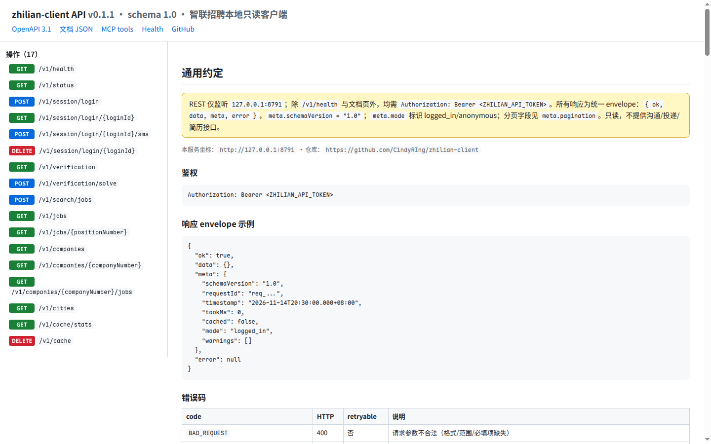

<p align="right"><a href="./README.md">← 文档索引</a></p>


# zhilian-client 部署与使用

> 目标：在一台 Linux 机器上常驻 `zhilian-client`，通过 CLI / REST / MCP 给 Agent 与业务系统提供智联招聘只读查询。环境配套见 [04-环境配套.md](./04-环境配套.md)。

---

> **端口**：tanji-client 占 8787–8789、boss-client 占 8790，本项目固定 **8791**（仅 `127.0.0.1`）。本文端点/操作 ID/错误码与 `docs/02-接口草案.md` 及 `spec/` 生成物同源，草案调整以生成的注册表为准。

## 🗺️ 本页导航

- [1. 与 boss-client 的关键差异](#1-与-boss-client-的关键差异)
- [2. 运行要求](#2-运行要求)
- [3. 安装](#3-安装)
- [4. 配置](#4-配置)
- [5. 登录](#5-登录)
- [6. 使用](#6-使用)
- [7. systemd 常驻](#7-systemd-常驻)
- [8. 观测与排障](#8-观测与排障)
- [9. 升级 / 维护](#9-升级--维护)
- [10. 安全与数据](#10-安全与数据)
- [11. 验收清单](#11-验收清单)

<details><summary>展开二级小节</summary>

  - [4.1 站点 · 登录 · 浏览器](#41-站点--登录--浏览器)
  - [4.2 REST · MCP · 运行 · 日志](#42-rest--mcp--运行--日志)
  - [4.3 缓存 TTL（秒）](#43-缓存-ttl秒)
  - [4.4 限频与风控](#44-限频与风控)
  - [5.1 智联 APP 扫码（默认，headless 可用）](#51-智联-app-扫码默认headless-可用)
  - [5.2 短信验证码（已实测，headful）](#52-短信验证码已实测headful)
  - [5.3 REST 中继（headless 推荐）](#53-rest-中继headless-推荐)
  - [5.4 EdgeOne 人机验证中继](#54-edgeone-人机验证中继)
  - [5.5 会话与自动登录（已实测）](#55-会话与自动登录已实测)
  - [6.1 CLI](#61-cli)
  - [6.2 CLI 远程模式（常驻服务运行时）](#62-cli-远程模式常驻服务运行时)
  - [6.3 REST](#63-rest)
  - [6.4 MCP（默认代理到常驻服务）](#64-mcp默认代理到常驻服务)
  - [6.5 SKILL](#65-skill)
  - [7.1 本机联调状态（2026-11-14）](#71-本机联调状态2026-11-14)

</details>

## 1. 与 boss-client 的关键差异

四形态、SQLite 缓存、systemd 常驻、MCP 默认代理全部同构；差异在上游站点：

| 维度 | boss-client | zhilian-client |
| --- | --- | --- |
| 登录 | BOSS App 扫码 / 短信 + 极验 | **智联招聘 App 扫码**（默认）+ 短信；微信扫码/密码仅预留接口 |
| 人机验证 | 极验 v4（登录阶段） | **腾讯云 EdgeOne**（`EO-Bot-Captcha-Token`，30 天）+ 数美设备指纹 + 阿里 NC/极验 v4（短信阶段） |
| 匿名可用性 | 有降级，字段较全 | 匿名只返回 **1 页 20 条**，`hasMore=false`，薪资显示 `**-**元` |
| 数据来源 | 页面内 XHR API | **SSR HTML 内嵌 `__INITIAL_STATE__`** 为主 + `fe-api` 的 `position-detailv3` 补充 |

1. 双域：登录在 `passport.zhaopin.com`，数据在 `www.zhaopin.com`，同一 profile 保存两域 cookie。
2. 直访 `/jobdetail/<positionNumber>.htm` 首次会被 EdgeOne 拦（标题 `Security Verification`）；`jobs detail` 主路径走 `position-detailv3` 不受影响，但搜索页/公司页仍可能被挑战；匿名只作降级（`pageIndex` 压回 1），不要靠 `p=2` 绕过。

## 2. 运行要求

| 项 | 要求 |
| --- | --- |
| OS | Linux（本机 NixOS 26.11；探路脚本已 headful 实测运行） |
| Node.js | ≥ 22.5（`node:sqlite`）；FHS 内 22.23.2，本机主环境亦 22.23.2 |
| 浏览器 | `~/cloak-env`：cloakbrowser 0.6.5 + Chromium 146.0.7680.177.5；缺失时仅 `health`/`docs` 可 `node dist/main.js` 直跑 |
| 显示 | 扫码可 headless；短信登录、EdgeOne 自动通过需 **headful**（桌面 DISPLAY 或 Xvfb） |
| 网络 | `www.zhaopin.com`、`passport.zhaopin.com`、`fe-api.zhaopin.com`、`cgate.zhaopin.com`、`captcha.eo.gtimg.com`、`t.captcha.qq.com`、`common-bucket.zhaopin.cn`、`*.zhaopin.cn`（静态资源/数美 `sense-v2.js`） |
| 账号 | 本人/授权智联招聘账号（只读） |

## 3. 安装

```bash
git clone <repo> zhilian-client && cd zhilian-client
npm install && cp .env.example .env   # 至少改 ZHILIAN_API_TOKEN；短信登录再填 ZHILIAN_PHONE
npm run build && npm test && npm run gen
mkdir -p ~/.local/bin && ln -sf "$PWD/bin/zhilian-run" ~/.local/bin/zhilian   # 项目移动后需重建软链
zhilian health
```

> 脚本：`build`=tsc→`dist/`、`test`=vitest（33 个单测，不启浏览器）、`gen`=生成 `spec/`、`gen:check`=漂移检查。`npm install` 的 `node:sqlite` 实验特性提示属 Node 22 正常 warning。

## 4. 配置

优先级：**CLI 参数 > 环境变量 > `.env` 文件 > 默认值**。启动时自动加载项目根 `.env`（`ZHILIAN_ENV_FILE` 可改路径），已 export 的变量不被覆盖；完整列表见 `.env.example`。必改：`ZHILIAN_API_TOKEN=<足够长的随机串>`；短信登录另需 `ZHILIAN_PHONE=<手机号>`。

### 4.1 站点 · 登录 · 浏览器

| 变量 | 默认 | 说明 |
| --- | --- | --- |
| `ZHILIAN_BASE_URL` / `ZHILIAN_API_BASE` | `https://www.zhaopin.com` / `https://fe-api.zhaopin.com` | 数据站点 / `fe-api`（详情 API、字典） |
| `ZHILIAN_LOGIN_URL` | `https://passport.zhaopin.com/login` | 登录页 |
| `ZHILIAN_CITIES` | `565` | 默认城市码，逗号分隔；489=全国、530=北京、765=深圳；`--city`/`cityCode` 可覆盖 |
| `ZHILIAN_SORT_TYPE` | `JOB_PUBLISH_TIME` | 翻页 API 排序：`DEFAULT`/`HR_ACTIVE_TIME`/`JOB_PUBLISH_TIME` |
| `ZHILIAN_REFRESH_AT_BEFORE_SEC` | `3600` | at 剩余低于该值时自动 refresh-token |
| `ZHILIAN_LOGIN_MODE` / `ZHILIAN_QR_POLL_MS` | `app-qr` / `2000` | `app-qr`（智联 APP 扫码）/ `sms`；轮询间隔（实测 2s、5 分钟有效） |
| `ZHILIAN_LOGIN_TIMEOUT_SEC` | `600` | loginId TTL / 登录总超时 |
| `ZHILIAN_PROFILE_DIR` | `~/.zhilian-client/profile` | **独立** profile，绝不与 boss/tanji 共用 |
| `ZHILIAN_HEADLESS` | `true` | 默认无头；短信 / EdgeOne 自动通过临时设 `false` |
| `ZHILIAN_HUMANIZE` | `true` | cloakbrowser 人类化输入/鼠标 |
| `CLOAK_ENV` | `~/cloak-env` | 共享 cloak 环境路径（非 `ZHILIAN_` 前缀） |

### 4.2 REST · MCP · 运行 · 日志

| 变量 | 默认 | 说明 |
| --- | --- | --- |
| `ZHILIAN_HOST` / `ZHILIAN_PORT` | `127.0.0.1` / `8791` | 只允许回环；REST 端口 |
| `ZHILIAN_API_TOKEN` | `change-me` | Bearer；除 `/v1/health` 外必需 |
| `ZHILIAN_CLIENT_URL` | 空 | 设置后 CLI/MCP 走 REST，不本地开浏览器 |
| `ZHILIAN_SESSION_FILE` / `ZHILIAN_LOCK_FILE` | `~/.zhilian-client/{session.json,run/zhilian.lock}` | storage state / 单实例锁 |
| `ZHILIAN_LOG_FILE` / `ZHILIAN_LOG_LEVEL` | `~/.zhilian-client/logs/zhilian.log` / `info` | JSONL 按大小轮转 / debug·info·warn·error |
| `ZHILIAN_LOG_MAX_BYTES` / `ZHILIAN_LOG_KEEP` | `10485760` / `5` | 单文件上限 / 保留份数 |
| `ZHILIAN_LOG_STDOUT` | `true` | 同时写 stdout（systemd 便于 journal） |

### 4.3 缓存 TTL（秒）

| 变量 | 默认 | 说明 |
| --- | --- | --- |
| `ZHILIAN_CACHE_DB` / `ZHILIAN_CACHE_DRIVER` | `~/.zhilian-client/cache.db` / `sqlite` | 缓存文件 / `memory` 可临时降级 |
| `ZHILIAN_CACHE_QUERY_TTL` / `ZHILIAN_CACHE_LIST_TTL` | `86400` / `7200` | queryId 24h / 职位列表 2h |
| `ZHILIAN_CACHE_JOB_DETAIL_TTL` | `43200` | 职位详情 12h |
| `ZHILIAN_CACHE_COMPANY_TTL` / `ZHILIAN_CACHE_COMPANY_JOBS_TTL` | `604800` / `7200` | 公司详情 7d / 公司全部职位 2h |

### 4.4 限频与风控

| 变量 | 默认 | 说明 |
| --- | --- | --- |
| `ZHILIAN_RATE_PER_MIN` / `ZHILIAN_CONCURRENCY` | `15` / `1` | 上游请求/分钟 / 单并发 |
| `ZHILIAN_MAX_PAGES` | `5` | 单任务最多页数 |
| `ZHILIAN_PAGE_DELAY_MS` / `ZHILIAN_PAGE_DELAY_JITTER_MS` | `2500` / `1500` | 页间基础延迟 + 抖动 → 实际 2.5–4s |
| `ZHILIAN_REQUEST_TIMEOUT_MS` | `30000` | 单请求超时 |
| `ZHILIAN_EDGE_AUTO` / `ZHILIAN_EDGE_WAIT_SEC` | `false` / `120` | 遇 EdgeOne 是否自动点复选框（默认中继优先）/ 等待上限 |
| `ZHILIAN_COOLDOWN_SEC` / `ZHILIAN_HEARTBEAT_SEC` | `60` / `300` | 连续验证失败冷却 / 登录态心跳（`checkToken`） |
| `ZHILIAN_ANONYMOUS` | `true` | 未登录时允许匿名降级查询 |

## 5. 登录

> 首次或掉线必须人工完成一次，之后靠 profile 复用。扫码**不需要**可视浏览器；短信与 EdgeOne 自动通过需要。

### 5.1 智联 APP 扫码（默认，headless 可用）

```bash
zhilian login              # 按 ZHILIAN_LOGIN_MODE，默认 app-qr
zhilian login --qr         # 显式扫码
zhilian login --qr --relay # 只输出 LoginSession（含 Base64 二维码），不等扫码
```

- 上游三段：`GET /v4/appScan/init?scene=10000060` → `GET /v4/appScan/img/<validateId>` → 轮询 `GET /v4/appScan/login?validateId=<id>&rememberMe=true`；轮询码 `102004` 待扫 · `102001` 已扫待确认 · `100000` 成功 · `102002/102003` 失效，二维码约 5 分钟有效。
- 成功后写 profile；**实测**：关闭浏览器/重启进程后同 profile 直接 `loggedIn=true`，无需重扫。

### 5.2 短信验证码（已实测，headful）

```bash
ZHILIAN_HEADLESS=false zhilian login --sms      # headful 最稳；短信流程本身可 headless 尝试
```

实测请求链（2026-11-14，真实账号登录成功）：

```text
1) POST /common/getEncryptKey?time=          → data.encryptKey（RSA 公钥）
2) GET  /passportService/verify/init?scene=10000020&countryCode=86&mobile=<加密>&encryptMobile=<加密>&encryptRequestId=<uuid>
        → {code:100000,data:{riskLevel,validateId,sessionId,geetestData:{success,challenge,gt}}}
        （本次极验自动通过，无人工交互；如出现挑战 → HUMAN_VERIFICATION_REQUIRED → 走 §5.4 中继）
3) GET  /v4/sms/init?scene=10101010&...&validateId=<verify 的 id>&validateData=<geetest JSON>
        → {code:100000,data:{validateId:<新 id>,isNewUser:false}}（短信已发送）
4) POST /v4/sms/loginAndRegister?validateId=<sms/init 的 id>&validateData=<6 位短信码>
        &rememberMe=true&agreementConsented=true&...
        → 302 i.zhaopin.com/blank → www.zhaopin.com/recommend（登录成功）
```

- 短信码字段是 `validateData`（不是 `code`）；`rememberMe=true`、`agreementConsented=true` 固定携带。
- CLI 交互：`zhilian login --sms --phone <手机号>` → 等待输入 6 位码 → `zhilian login sms <loginId> --code <code>`（REST 同义 `/v1/session/login/{loginId}/sms`）。

### 5.3 REST 中继（headless 推荐）

```bash
# 1) 开始扫码登录 -> data.qr.pngBase64（展示给终端/前端，用智联 APP 扫码）
curl -X POST http://127.0.0.1:8791/v1/session/login \
  -H "Authorization: Bearer $ZHILIAN_API_TOKEN" -H "content-type: application/json" -d '{"mode":"app-qr"}'
# 2) 轮询状态
curl -H "Authorization: Bearer $ZHILIAN_API_TOKEN" http://127.0.0.1:8791/v1/session/login/<loginId>
# 3) 短信登录：先 POST {"mode":"sms","phone":"<手机号>"}，再提交 6 位码
curl -X POST http://127.0.0.1:8791/v1/session/login/<loginId>/sms \
  -H "Authorization: Bearer $ZHILIAN_API_TOKEN" -H "content-type: application/json" -d '{"code":"<6位验证码>"}'
```

`state`：`starting` / `awaiting_scan` / `awaiting_confirm`（已扫码待手机确认） / `awaiting_captcha` / `awaiting_sms_code` / `logged_in` / `failed` / `expired` / `cancelled`；取消用 `DELETE /v1/session/login/<loginId>`。

### 5.4 EdgeOne 人机验证中继

搜索页、公司页、`/jobdetail` 直访都可能被拦；操作返回 `HUMAN_VERIFICATION_REQUIRED`，`error.details.verification` 内含挑战信息。

```bash
# 1) 取待处理挑战 -> data.challenge.screenshotBase64 / iframe / checkbox
curl -H "Authorization: Bearer $ZHILIAN_API_TOKEN" http://127.0.0.1:8791/v1/verification
# 2a) 自动通过（headful；点击 iframe 内 #verifyCheckbox）
curl -X POST http://127.0.0.1:8791/v1/verification/solve \
  -H "Authorization: Bearer $ZHILIAN_API_TOKEN" -H "content-type: application/json" -d '{"kind":"edgeone","auto":true}'
# 2b) 人工/远程点击（坐标 0-1 归一化，相对挑战截图）
curl -X POST http://127.0.0.1:8791/v1/verification/solve \
  -H "Authorization: Bearer $ZHILIAN_API_TOKEN" -H "content-type: application/json" \
  -d '{"kind":"edgeone","points":[{"x":0.12,"y":0.28}]}'
```

CLI 等价：`zhilian verify status`；`zhilian verify solve --kind edgeone --auto`；`zhilian verify solve --kind edgeone --points 0.12,0.28`。

- 实测通过方式：点击 iframe（`#tcaptcha_iframe_eo`）内 `#verifyCheckbox`，约 5s 后写 cookie 并重载；**headless 下 `solve auto=true` 也已实测通过**。
- **公司页同样会触发 EdgeOne**（`/companydetail/*`、`/companydetail/jobs-*`）：返回 `HUMAN_VERIFICATION_REQUIRED` → 走本節中继 → 重试即可（实测公司详情/公司职位均如此）。
- 通过后写 `EO-Bot-Captcha-Token`（`.zhaopin.com`，**30 天**），`status.verification.edgeTokenExpiresAt` 可看到期时间。
- headless 下能否通过挑战**待实测确认**；稳妥做法是 headful 过一次，之后 headless 复用 token。

### 5.5 会话与自动登录（已实测）

| 项 | 实测 |
| --- | --- |
| 登录态 cookie | `at`（access token，约 **7 天**）、`rt`（refresh token，约 **30 天**），`.zhaopin.com`、非 HttpOnly、SameSite=Lax |
| 自动登录 | 关闭浏览器/重启进程后同 profile 直接已登录（`checkToken=true`）；rt 30 天内有效 |
| 心跳 | `zhilian status` 调 `GET /c/i/checkToken`（`data=true`）+ `GET /c/i/user/detail` |
| 主动续期 | `POST https://fe-api.zhaopin.com/c/i/refresh-token` body `{"rt":"<rt>"}` → `{at,atExpire,rt,rtExpire,userInfo}`；建议 at 剩余 <1h 时刷新并回写 cookie（`ZHILIAN_REFRESH_AT_BEFORE_SEC`，见 §4） |
| 失效 | rt 过期/被踢 → `status.health=needs_human`，按 §5.1/5.2 重新登录 |

> `at`/`rt` 是账号凭证：不要写日志、不要贴聊天、不要入库；`status` 只返回到期时间与脱敏账号信息。

## 6. 使用

### 6.1 CLI

```bash
zhilian health && zhilian status
# 搜索（匿名只 1 页 20 条；登录后可 --pages）
zhilian search jobs --keyword 外贸 --city 565 --order 4 --page 1 --pages 1
zhilian jobs list --query-id q_20261114_ab12cd --page 2
# 职位详情（positionNumber）
zhilian jobs detail --number CCL1316344860J40974823208   # 走 position-detailv3，免 EdgeOne
zhilian companies list --query-id q_20261114_ab12cd --fetch-pages 1
zhilian companies detail --number CZL1515276460
zhilian companies jobs --number CZL1515276460 --page 1
zhilian cities list --refresh && zhilian cache stats && zhilian cache clear --expired
```

- 默认输出统一 envelope JSON（`ok/data/meta/error`），`--format table` 为简表；`--refresh` 绕过缓存。
- 分页机制（实测）：第 1 页 SSR；第 2 页起自动调 load-more API（`POST /c/i/search/positions`）；单任务保持 `--pages ≤5`。
- 登录后薪资正常显示（匿名显示 `**-**元`）；匿名仅 1 页 20 条。

### 6.2 CLI 远程模式（常驻服务运行时）

```bash
export ZHILIAN_CLIENT_URL=http://127.0.0.1:8791
export ZHILIAN_API_TOKEN=<token>
zhilian status && zhilian search jobs --keyword 外贸 --city 565
```

走 REST，不再启动第二个浏览器，避免与 systemd 进程争抢 profile。

### 6.3 REST

```bash
zhilian serve --port 8791
curl http://127.0.0.1:8791/docs && curl http://127.0.0.1:8791/openapi.json   # 文档
curl http://127.0.0.1:8791/v1/health                                        # 唯一免鉴权
curl -H "Authorization: Bearer $ZHILIAN_API_TOKEN" http://127.0.0.1:8791/v1/status
curl -X POST http://127.0.0.1:8791/v1/search/jobs \
  -H "Authorization: Bearer $ZHILIAN_API_TOKEN" -H "content-type: application/json" \
  -d '{"keyword":"外贸","cityCode":"565","page":1,"pages":1,"order":4}'
curl -H "Authorization: Bearer $ZHILIAN_API_TOKEN" 'http://127.0.0.1:8791/v1/jobs?queryId=<queryId>&page=2'
curl -H "Authorization: Bearer $ZHILIAN_API_TOKEN" http://127.0.0.1:8791/v1/companies/<companyNumber>
```

### 6.4 MCP（默认代理到常驻服务）

MCP 进程**不持有浏览器/profile**，默认代理到 `ZHILIAN_CLIENT_URL`（缺省 `http://127.0.0.1:8791`）。先确认 `systemctl --user status zhilian-client` 为 active。

```json
{
  "mcpServers": { "zhilian-client": {
    "command": "/home/<user>/zhilian-client/bin/zhilian-run",
    "args": ["mcp"],
    "env": { "ZHILIAN_CLIENT_URL": "http://127.0.0.1:8791", "ZHILIAN_API_TOKEN": "<token>" }
  } }
}
```

- 默认 `zhilian mcp`：**总是代理**；服务不可用返回 `SERVICE_UNAVAILABLE`，不本地开浏览器。`--proxy` 强制代理。
- `zhilian mcp --local`：强制本地 App；常驻服务运行时会导致 `ALREADY_RUNNING`，仅开发/无服务时用。
- 工具：`zhilian_health`、`zhilian_status`、`zhilian_login_*`、`zhilian_verification_get`/`zhilian_verification_solve`、`zhilian_search_jobs`、`zhilian_list_jobs`、`zhilian_job_detail`、`zhilian_list_companies`、`zhilian_company_detail`、`zhilian_company_jobs`、`zhilian_cities`、`zhilian_cache_*`（详见 `spec/mcp-tools.json`）。

### 6.5 SKILL

`skills/zhilian/SKILL.md` 描述只读流程（体检 → 搜索 → 公司聚合 → 详情），约定遇 `HUMAN_VERIFICATION_REQUIRED` 停下走 `zhilian verify` 中继、遇 `RATE_LIMITED` 退避、不并发、不投递。

## 7. systemd 常驻

```bash
mkdir -p ~/.config/systemd/user
cp systemd/zhilian-client.service ~/.config/systemd/user/
systemctl --user daemon-reload && systemctl --user enable --now zhilian-client
systemctl --user status zhilian-client && journalctl --user -u zhilian-client -f
```

```ini
[Service]
WorkingDirectory=%h/zhilian-client
EnvironmentFile=-%h/zhilian-client/.env
Environment=ZHILIAN_LOG_STDOUT=true
ExecStart=%h/zhilian-client/bin/zhilian-run serve --port 8791
Restart=always
RestartSec=5
# 需要自动过 EdgeOne/短信时再开：
# Environment=DISPLAY=:99
# ExecStartPre=/usr/bin/Xvfb :99 -screen 0 1440x900x24
```

项目不在 home 下时改 `WorkingDirectory` / `EnvironmentFile` / `ExecStart`。

### 7.1 本机联调状态（2026-11-14）

- `zhilian-client.service` 已启用并运行在 `127.0.0.1:8791`；`/v1/health` 毫秒级；`/v1/status` → `loggedIn=true, health=ok`。
- REST 全链路实测通过：search（1/2 页）、jobs.list、jobs.detail、companies.detail（含 EdgeOne 中继）、companies.jobs（>20 条全量）、cities、cache。
- CLI 远程模式（自动探测 8791）实测通过：`zhilian status` / `zhilian search jobs` / `zhilian companies list`。
- MCP stdio 实测：`initialize` / `tools/list`（17）/ `tools/call`（`zhilian_status`）。
- 终端二维码：上游为 JPEG，CLI 保存到 `~/.zhilian-client/tmp/login-qr-*.jpg` 并打印路径；REST 返回 `qr.pngBase64`。



> 截图：`http://127.0.0.1:8791/docs`（真实运行，v0.1.1）。

## 8. 观测与排障

| 现象 / 错误码 | 原因 | 处理 |
| --- | --- | --- |
| `AUTH_REQUIRED` / `SESSION_EXPIRED` | 未登录或登录态失效（`checkToken` 为 false） | `zhilian login --qr` 重新扫码 |
| `ANONYMOUS_LIMITED` / `LOGIN_REQUIRED` | 未登录：仅 1 页 20 条、薪资 `**-**元` | 登录解锁；不要靠 URL `p=` 绕过（第 2 页起须走 load-more API） |
| 登录后仍弹 EdgeOne | 登录/风险变化会重新触发挑战（实测一次） | 重新走 `zhilian verify`；通过后 token 再续 30 天 |
| `HUMAN_VERIFICATION_REQUIRED` | EdgeOne 挑战（`/jobdetail` 直访、token 过期）或登录极验/NC | `zhilian verify status` → `zhilian verify solve --kind edgeone --auto`，或提交截图坐标 |
| `CAPTCHA_REQUIRED` | 登录/发码触发阿里 NC 或极验 v4 | headful（桌面/Xvfb）中继；降低登录频率；不要自动破解 |
| `RATE_LIMITED` | 超本地限频或上游频控 | 按 `retryAfterMs` 退避；降 `ZHILIAN_RATE_PER_MIN`、加页间延迟 |
| `UPSTREAM_BLOCKED` | 上游 403 / 挑战页 / 账号级限流 | 停止任务，等 `status.risk.cooldownUntil`；必要时人工过一次 EdgeOne |
| `UPSTREAM_CHANGED` | `__INITIAL_STATE__` 缺失或结构变化（改版） | 查日志 adapter 警告；抓 HTML 到 `exploration/` 后更新解析 |
| `CACHE_ERROR` | SQLite 损坏/权限/磁盘满 | `cache stats` 排查；`ZHILIAN_CACHE_DRIVER=memory` 临时降级；修权限后重建 |
| `SERVICE_UNAVAILABLE` | 常驻 REST 未启动或端口不符 | `systemctl --user start zhilian-client`；核对 `ZHILIAN_CLIENT_URL` |
| `ALREADY_RUNNING` | 同一 profile 已有进程（`userDataDir` 被占用） | MCP 应默认代理；`pgrep -af zhilian`；停服务后仍锁可清 `~/.zhilian-client/run/zhilian.lock` |
| `HEADFUL_REQUIRED` | 无 DISPLAY（短信/EdgeOne 自动/点击） | 桌面或 Xvfb；或改 `--relay` 人工完成 |
| 浏览器启动失败 / 登录页空白无二维码 | FHS·Chromium·DISPLAY·profile；或登录页改版/JS 未加载完 | 见 [04-环境配套.md](./04-环境配套.md) §9；确认 `passport.zhaopin.com/login` 可达并复测 adapter |
| SQLite 实验特性 warning | Node 22 正常提示 | 不影响；可 `ZHILIAN_CACHE_DRIVER=memory` |

日志 `~/.zhilian-client/logs/zhilian.log`（JSONL，按大小轮转）只记录 operationId/耗时/状态码/错误码，不记录手机号、验证码、cookie、token、二维码原文。

## 9. 升级 / 维护

```bash
cd zhilian-client && git pull && npm install
npm run build && npm test && npm run gen
systemctl --user restart zhilian-client
```

- cloakbrowser 与 cloak-env 保持一致并锁定 **0.6.5**（0.7.x 起需 license key）；站点改版（EdgeOne 模板、`__INITIAL_STATE__`、`position-detailv3` 字段）只需更新 `adapters/zhilian` 与 fixtures，再 `npm run gen`，`npm run gen:check` 做 CI 漂移检查。
- 升级后回归：搜索（登录/匿名各一次）、职位详情（positionNumber：内嵌 → position-detailv3 → 页面 SSR）、公司详情（工商信息）、公司全部职位、EdgeOne 中继。

## 10. 安全与数据

- REST 仅 `127.0.0.1` + 除 `/v1/health` 外强制 Bearer；不要把端口暴露公网或做端口转发。
- `~/.zhilian-client/`、`profile/` 700；`cache.db`、`session.json`、`.env`、日志 600；均含登录态，注意备份/清理。
- 缓存只存结构化字段（职位/公司/详情/工商），不存 raw HTML、`__INITIAL_STATE__` 原文、cookie、验证码、二维码图片。
- 中继用二维码/挑战截图仅内存与本机临时文件；`exploration/**/artifacts/` 不入库、不贴聊天。只读合规：不投递、不沟通、不改简历、不收藏；单账号低频；遵守智联招聘用户协议与当地法律。

## 11. 验收清单

- [ ] `zhilian health` 返回 `ok:true`
- [ ] `zhilian login --qr` 扫码成功；重启进程后 `zhilian status` 仍 `loggedIn=true`
- [ ] `zhilian search jobs --keyword 外贸 --city 565` 返回 20 条职位 + 公司聚合；登录后 `--pages 2` 可翻页
- [ ] `zhilian jobs detail --number <positionNumber>` 返回描述/公司（走 `position-detailv3`，免 EdgeOne）
- [ ] `zhilian companies detail --number <companyNumber>` 返回工商信息（USCC/法人/注册资本）；`companies jobs` 返回**全部**在招职位（>20 条也完整）
- [ ] `zhilian cities list` 返回省/市/区县（实测基线 34 省 / 457 市 / 2870 区县）
- [ ] EdgeOne 挑战可由 `verification.get/solve` 中继完成，`status.verification.edgeTokenExpiresAt` 约 30 天后（登录后仍可再次触发并可再次处理）
- [ ] `status.session.atExpiresAt`/`rtExpiresAt` 分别约 7/30 天；`refresh-token` 调用成功
- [ ] 重启进程后 `zhilian status` 仍 `loggedIn=true`（profile 复用）
- [ ] `/v1/health` 免鉴权；无 token 访问 `/v1/status` 返回 401；`/openapi.json` 正常；常驻服务运行时 `zhilian mcp` 默认代理，不出现 `ALREADY_RUNNING`
- [ ] `stat -c '%a %n' ~/.zhilian-client ~/.zhilian-client/profile` 为 700，`cache.db`/日志为 600
- [ ] 日志无手机号、验证码、cookie、token 明文
