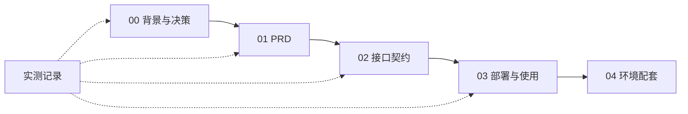

# zhilian-client 文档

**智联招聘 Web 的本地只读客户端** · 实现说明 / 接口契约 / 部署运维

  
  
  
  

[← 返回项目 README](../README.md)

> [!TIP]
> **第一次来？** 直接看 [03-部署与使用](./03-部署与使用.md) 的「快速开始」，5 分钟跑起来；
> 想了解设计取舍，再按 [00 访谈记录](./00-需求访谈记录.md) → [01 PRD](./01-需求文档.md) → [02 接口契约](./02-接口草案.md) 读。

## 🧭 我该从哪里开始

| 我的目标 | 建议阅读 |
| --- | --- |
| 5 分钟跑起来 / 部署 / 排障 | [03-部署与使用](./03-部署与使用.md) |
| 查接口字段 / 写调用代码 | [02-接口草案](./02-接口草案.md) + [`spec/`](../spec) |
| 了解为什么这样设计、边界在哪 | [00-需求访谈记录](./00-需求访谈记录.md) → [01-需求文档](./01-需求文档.md) |
| 换机器 / 升级 cloak-env / 权限问题 | [04-环境配套](./04-环境配套.md) |
| 核对上游事实与联调数据 | [实测记录](../exploration/2026-11-14/REPORT.md) |

## 📚 文档地图

| 文档 | 你会看到什么 | 适合 |
| --- | --- | --- |
| [00 需求访谈记录](./00-需求访谈记录.md) | 背景、用户结论、探路发现、命名/端口/默认值决策、与 boss-client 差异 | 产品、决策者 |
| [01 需求文档（PRD）](./01-需求文档.md) | 目标/非目标、架构、FR-1～FR-15、风控策略、验收标准、实现结果 | 所有人 |
| [02 接口草案](./02-接口草案.md) | envelope、错误码、17 个操作、数据模型、上游字段映射、联调结果 | 后端 / Agent 开发者 |
| [03 部署与使用](./03-部署与使用.md) | 安装、配置、登录、CLI/REST/MCP、systemd、观测排障、验收清单 | 部署、运维、使用者 |
| [04 环境配套](./04-环境配套.md) | cloak-env/FHS、版本、profile、cookie、DISPLAY/Xvfb、权限、FAQ | 环境维护者 |
| [实测记录](../exploration/2026-11-14/REPORT.md) | 2026-11-14 探路与联调：登录、搜索、详情、公司、EdgeOne、分页 | 想核对上游事实的人 |

## 🗺️ 阅读路径

## 🖼️ 图片素材

| 文件 | 用途 | 来源 |
| --- | --- | --- |
| [hero-banner.jpg](./assets/hero-banner.jpg) | README 顶部横幅 | MiniMax-H3-Image 生成 |
| [logo.jpg](./assets/logo.jpg) | 项目 Logo / 文档标识 | MiniMax-H3-Image 生成 |
| [architecture-illustration.jpg](./assets/architecture-illustration.jpg) | 架构章节概念图 | MiniMax-H3-Image 生成 |
| [social-preview.jpg](./assets/social-preview.jpg) | 文档封面 / 社交预览 | MiniMax-H3-Image 生成 |
| [rest-docs.png](./assets/rest-docs.png) | REST 文档页截图 | 真实运行截图（`127.0.0.1:8791/docs`） |

> 素材生成说明见 [assets/README](./assets/README.md)。

## 📌 文档状态

| 文档 | 状态 | 最近更新 |
| --- | --- | --- |
| 00 需求访谈记录 | ✅ 定稿 | 2026-11-14 |
| 01 需求文档（PRD） | ✅ 已实现 | 2026-11-14 |
| 02 接口草案 | ✅ 已实现（v0.1.1） | 2026-11-15 |
| 03 部署与使用 | ✅ 已实测 | 2026-11-15 |
| 04 环境配套 | ✅ 已定稿 | 2026-11-14 |
| 实测记录 | ✅ 已归档 | 2026-11-15 |

---

> 文档中的命令/端点与 `src/api/operations.ts` 及 `spec/` 生成物同源；发现不一致时以生成物与实机为准，并提 issue。
